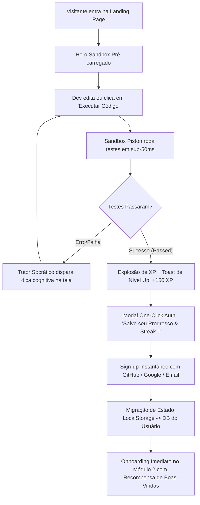

# 🚀 NEXUS CODE — Product & UX Strategy Specification: Master Landing Page
> **Lead Product & UX Strategist Document**  
> *Target: Arquitetura de Informação, Conversão Developer-First, Demonstrações Interativas & Ativação Pré-Cadastro*  
> *Status: Aprovado para Implementação | Versão: 1.0.0*

---

## 1. Visão Geral & Posicionamento Estratégico do Produto

### 1.1 Tese de Produto & Proposta de Valor
A **NEXUS CODE** resolve a maior dor do aprendizado de tecnologia contemporâneo: o **"Tutorial Hell"** (ilusão de aprendizado gerada pelo consumo passivo de centenas de horas de vídeo sem retenção cognitiva).

Enquanto plataformas legadas entregam vídeos pré-gravados e plataformas de algoritmos puras (ex: LeetCode) focam em quebra-cabeças descontextualizados, a NEXUS CODE posiciona-se como a **Engine de Aprendizado Ativo & Portfólio Criptografado para Engenheiros de Software**.

```
┌────────────────────────────────────────────────────────────────────────────────────────┐
│                                 NEXUS VALUE PROPOSITION                                │
│                                                                                        │
│   [ ZERO TUTORIAL HELL ]          [ 100% CÓDIGO REAL ]          [ IA SOCRÁTICA ]       │
│   Sem vídeos infinitos.           Ambientes Piston isolados.    Perguntas cognitivas,  │
│   Aprenda resolvendo bugs         Testes unitários rigorosos    arquitetura e linting, │
│   e construindo sistemas.         e deploy em sub-50ms.         sem entregar a resposta│
└────────────────────────────────────────────────────────────────────────────────────────┘
```

### 1.2 Métricas-Chave de Conversão (Product KPIs)
1. **Time to First Code Execution (TTFCE):** $< 8\text{ segundos}$ a partir do primeiro carregamento da Landing Page.
2. **Pre-Auth Engagement Rate (PAER):** $\ge 38\%$ dos visitantes interagem com o editor/sandbox do Hero antes de rolar a página.
3. **Visitor-to-Lead Activation (Sign-up):** $\ge 14.5\%$ de taxa de conversão direta (Visitante $\rightarrow$ Cadastro Concluído).
4. **Day-1 Retention via State Transfer:** $\ge 62\%$ dos usuários que executam código no Hero concluem o primeiro módulo guiado dentro de 24h.

---

## 2. Arquitetura de Informação (IA) & Mapa de Navegação da Landing Page

```
┌────────────────────────────────────────────────────────────────────────────────────────┐
│ [01] ULTRA-CLEAN TOPBAR / NAVBAR (Status Live + Context Nav + Direct Auth)             │
├────────────────────────────────────────────────────────────────────────────────────────┤
│ [02] HERO SECTION: ACTIVE CODE ENGINE (Live Editable Sandbox, Instant Run & AI Toast)  │
├────────────────────────────────────────────────────────────────────────────────────────┤
│ [03] SOCIAL PROOF & METRICS STRIP (Sober Tech Logos, SLA 99.98%, 42k+ Submissions)    │
├────────────────────────────────────────────────────────────────────────────────────────┤
│ [04] 4 INTERACTIVE FEATURE SHOWCASES:                                                 │
│      ├─ 4.1 Live Isolated Sandbox (Kernel Piston, Multi-language & Test Runner)        │
│      ├─ 4.2 AI Socratic Code Review (Diff Inspector, Anti-Cheat & Cognitive Guidance)  │
│      ├─ 4.3 Interactive Tech Tracks (Rust, Go, Next.js & AI Systems Visual Explorer)   │
│      └─ 4.4 Engineering Gamification & B2B Dossier (Streaks, Leagues & SHA-256 Badges) │
├────────────────────────────────────────────────────────────────────────────────────────┤
│ [05] DEEP SOCIAL PROOF & CAREER IMPACT (Promotions, Transition Stories, Staff Reviews) │
├────────────────────────────────────────────────────────────────────────────────────────┤
│ [06] VALUE PROPOSITION MATRIX (Nexus Code vs Video Bootcamps vs Algorithm Grinders)    │
├────────────────────────────────────────────────────────────────────────────────────────┤
│ [07] TRANSPARENT PRICING TIERS (Explorer R$ 0 / Pro Mensal & Anual / Enterprise B2B)  │
├────────────────────────────────────────────────────────────────────────────────────────┤
│ [08] TECHNICAL ACCORDION FAQ & HIGH-DENSITY FOOTER (Direct Platform Links & Docs)     │
└────────────────────────────────────────────────────────────────────────────────────────┘
```

---

## 3. Especificação Detalhada das Seções da Landing Page

### 3.1 Header Ultra-Clean & Status de Infraestrutura
O cabeçalho foi desenhado com foco em **densidade de informação, sobriedade técnica e zero distração**, flutuando com efeito de vidro fosco (*Obsidian Glassmorphism*).

```
┌──────────────────────────────────────────────────────────────────────────────────────┐
│ [⚡ NEXUS CODE]  Trilhas   Sandbox   IA Socrática   Ligas  │ ● Piston Engine: 18ms │ [Entrar] [Criar Conta Grátis] │
└──────────────────────────────────────────────────────────────────────────────────────┘
```

#### Componentes & Comportamentos:
1. **Brand Identity:** Isotipo SVG Squircle Neon (`#8257E5` + `#04D361`) + Wordmark em tipografia `Space Grotesk` (peso 700) com tag `DEV/ENGINE`.
2. **Navegação Contextual com Scroll Suave:**
   - `Trilhas`: Âncora para o explorador de especialização (`#tracks`).
   - `Sandbox & Terminal`: Âncora para a demonstração da engine de execução (`#sandbox`).
   - `IA Socrática`: Âncora para a demonstração do revisor de código (`#ai-tutor`).
   - `Ligas & Gamificação`: Âncora para o sistema de classificação e portfólio (`#gamification`).
   - `Preços`: Âncora para a tabela de planos (`#pricing`).
3. **Live Infrastructure Status Pill:**
   - Indicador com pulso neon verde (`#04D361` com animação `animate-ping`).
   - Label: `Piston Sandbox: 18ms latency • 99.98% uptime`.
   - Tooltip dinâmico: Exibe o cluster regional ativo (`AWS us-east-1 / Edge Workers`).
4. **CTAs de Autenticação:**
   - `Entrar (Sign In)`: Botão secundário (`text-[#94A3B8] hover:text-white transition-colors`).
   - `Criar Conta (Get Started)`: Botão de alto contraste com gradiente sutil violeta/esmeralda, ícone de terminal e microcopy: *"Comece a codar agora"*.

---

### 3.2 Hero Section com Editor & Sandbox Interativo ao Vivo (Zero Vídeo)
A Hero Section rejeita vídeos em loop ou mockups estáticos de marketing. O desenvolvedor é recebido com uma **IDE real funcional embutida no navegador**, onde ele pode alterar o código, clicar em "Executar" e receber feedback imediato dos testes unitários.

```
┌─────────────────────────────────────────────────────────────────────────────────────────┐
│ [⚡ ZERO TUTORIAL HELL • APRENDIZADO ATIVO]                                            │
│ Domine Engenharia de Software                                ┌────────────────────────┐│
│ Escrevendo Código Real.                                      │ main.ts (TypeScript) ▾ ││
│                                                              ├────────────────────────┤│
│ Chega de assistir a 80 horas de vídeo passivo. Na Nexus      │ 1 export function      ││
│ Code você resolve desafios de sistemas reais, recebe         │ 2   rateLimiter(req) { ││
│ code reviews socráticos por IA e constrói um dossiê técnico  │ 3     // Corrija aqui  ││
│ com testes automatizados verificados por criptografia.       │ 4     return true;     ││
│                                                              │ 5 }                    ││
│ [ ⚡ Executar Código Grátis ]   [ 🎯 Explorar Trilhas ]       ├────────────────────────┤│
│                                                              │ ▶ Terminal: [PASSED 3] ││
│ 🛡️ Sem necessidade de cartão de crédito. Comece em 1 clique.  │ 🤖 IA: "Complexidade O ││
└─────────────────────────────────────────────────────────────────────────────────────────┘
```

#### Elementos e Arquitetura do Hero:
- **Badge de Alerta Superior:** `⚡ REVOLUÇÃO NO ENSINO TECH • ZERO TUTORIAL HELL`.
- **H1 Headline:** `Domine Engenharia de Software Escrevendo Código Real.` (com gradiente de texto `linear-gradient(135deg, #FFF 60%, #94A3B8 100%)`).
- **Subtítulo:** `Chega de assistir a 80 horas de vídeo passivo. Resolva desafios de backend, concorrência e frontend moderno com execução isolada sub-50ms e tutoria socrática por IA.`
- **Micro-Conversão Pré-Cadastro:**
  - Botão Primário: `⚡ Executar Código Grátis` (aciona o runner em background via Piston API).
  - Botão Secundário: `🎯 Explorar 4 Trilhas de Carreira`.
- **Hero Sandbox Widget (Interactive Playground):**
  - Seletor de Linguagens: `TypeScript`, `Python`, `Go`, `Rust`.
  - Código Pré-carregado: Um desafio prático instantâneo (ex: *Implementar Token Bucket Rate Limiter* ou *Algoritmo de Deduplicação de Logs em Go*).
  - Botão de Ação: `▶ Executar Testes (Ctrl + Enter)`.
  - Terminal de Saída: Feedback visual com cores de status:
    - 🟢 `[TEST 1] Rate limit burst threshold: PASSED (1.2ms)`
    - 🟢 `[TEST 2] Sliding window expiration: PASSED (0.8ms)`
    - 🟢 `[TEST 3] Memory consumption < 4MB: PASSED`
  - Feedback Toast IA Socrática: Pop-up lateral inteligente:
    > *"Excelente solução! Notei que você utilizou um Map em memória. Como essa estrutura se comportaria se sua aplicação fosse distribuída em 4 instâncias no Kubernetes?"*

---

### 3.3 Social Proof Strip (Autoridade & Métricas de Engenharia)
Faixa de alta credibilidade técnica, evitando selos genéricos de marketing e focando em métricas reais de execução e empresas onde nossos alunos e instrutores atuam:

- **Métricas em Tempo Real:**
  1. `4.2M+` Linhas de código compiladas em sandbox seguro.
  2. `99.98%` Uptime do cluster de execução Piston.
  3. `18ms` Latência média de feedback de testes unitários.
  4. `84%` Taxa de aprovação técnica em entrevistas de alunos com Streak > 30 dias.
- **Logos Sóbrios de Referência (Mono-White com Opacidade 40%):**
  - Empresas de referência do ecossistema: *Nubank, Mercado Livre, Vercel, AWS, Cloudflare, Stone, iFood, QuintoAndar*.

---

### 3.4 Interactive Feature Showcases (Os 4 Pilares da Plataforma)

```
┌─────────────────────────────────────────────────────────────────────────────────────────┐
│                               OS 4 PILARES DA NEXUS CODE                                │
├─────────────────────────────────────────┬───────────────────────────────────────────────┤
│ [1] SANDBOX ISOLADO SUB-50MS            │ [2] CODE REVIEW SOCRÁTICO POR IA              │
│ - Execução real em containers gVisor    │ - Não dá a resposta pronta: faz pensar        │
│ - Zero dependência local / Node/Go/Rust │ - Análise AST de performance e segurança      │
│ - Terminal interativo com streams ANSI  │ - Dicas graduais (Level 1: Dica, Level 3: Ref)│
├─────────────────────────────────────────┼───────────────────────────────────────────────┤
│ [3] TRILHAS DE ESPECIALIZAÇÃO VIVAS     │ [4] GAMIFICAÇÃO & DOSSIÊ B2B CRIPTOGRAFADO    │
│ - Rust, Go Concurrency, Fullstack Next │ - Ligas semanais estilo Duolingo (Elo Rating) │
│ - Arquitetura de Sistemas Distribuídos  │ - Heatmap de commits e Talent Trees RPG       │
│ - Projetos reais com CI/CD simulado     │ - Dossiê verificado com hash SHA-256          │
└─────────────────────────────────────────┴───────────────────────────────────────────────┘
```

#### 3.4.1 Showcase 1: Sandbox Live com Terminal & Output
- **Objetivo:** Provar que a plataforma não usa compiladores fake em JavaScript no cliente.
- **Interface:** Editor Monaco/CodeMirror dark com syntax highlighting, terminal xterm.js responsivo, abas de arquivos (`solution.go`, `solution_test.go`, `benchmark_test.go`).
- **Recursos Chave:**
  - Medição de tempo de CPU e consumo de memória (RSS) em tempo real.
  - Testes de mutação e edge cases automáticos.
  - Suporte completo a I/O padrão (`stdin`, `stdout`, `stderr`).

#### 3.4.2 Showcase 2: AI Code Review Socrático
- **Diferenciação:** O ChatGPT comum entrega o código pronto, destruindo o aprendizado. O Tutor Socrático da Nexus atua como um **Staff Engineer mentor**:
  - Mostra o **Diff Visual** do código do aluno vs Melhores Práticas.
  - Realiza perguntas guiadas baseadas no erro: *"Você utilizou uma busca linear $O(N)$ dentro de um loop $O(N)$. Que estrutura de dados hash poderia reduzir essa complexidade para $O(1)$ amortizado?"*.
  - Medidor de "Cognitive Growth" (recompensa por chegar à resposta por dedução).

#### 3.4.3 Showcase 3: Trilha de Especialização Interativa (Explorador de Módulos)
- **Visualizador Dinâmico:** O usuário pode alternar entre 4 grandes trilhas e inspecionar a árvore de habilidades (Talent Tree):
  1. **Go Distributed Systems:** Goroutines, Channels, gRPC, Raft Consensus, Distributed Locks com Redis.
  2. **Rust & High Performance:** Memory Safety, Ownership, Lifetimes, Tokio Async, WebAssembly & CLI Engines.
  3. **Next.js & Fullstack Moderno:** Server Actions, React 19 Compiler, Edge Middleware, Drizzle ORM, WebSockets.
  4. **AI Engineering & LLMOps:** Semantic Search, RAG Pipelines, Vector Databases (PgVector), Agent Function Calling.
- Cada nó na trilha exibe: Pré-requisitos, tempo estimado de código, quantidade de testes práticos e badges desbloqueáveis.

#### 3.4.4 Showcase 4: Gamificação de Engenharia & Dossiê B2B Criptografado
- **Mecânicas de Retenção & Carreira:**
  - **Ligas Semanais (Bronze, Prata, Ouro, Diamante, Mestre da Sintaxe):** Promoção e rebaixamento dinâmico aos domingos às 23:59 UTC.
  - **Streak Multiplier (Fogo da Sintaxe):** Multiplicador de XP cumulativo por dias consecutivos de commits.
  - **Dossiê Público para Recrutadores (`nexuscode.dev/u/username`):**
    - Radar de Competências pentagonal (Algoritmos, Concorrência, Testabilidade, Clean Code, Arquitetura).
    - Código-fonte auditável com hash SHA-256 e logs de passagem em testes unitários.
    - Exportação em 1 clique para PDF técnico de alta densidade.

---

### 3.5 Prova Social Profunda (Engenheiros Reais & Histórias de Transição)
Substitui avaliações genéricas de "5 estrelas" por **histórias detalhadas de progressão de carreira**:

| Desenvolvedor | Cargo Anterior $\rightarrow$ Cargo Atual | Depoimento Técnico | Empresa Contratante |
| :--- | :--- | :--- | :--- |
| **Matheus Alencar** | Dev Júnior (PHP Legado) $\rightarrow$ **Mid Backend (Go)** | *"O diferencial na minha entrevista foi abrir meu perfil da Nexus Code e mostrar a suite de testes do projeto de mensageria com SHA-256 verificado. O Tech Lead disse que foi o portfólio mais sólido que avaliou no ano."* | **Fintech Unicorn** |
| **Beatriz Mendes** | Frontend React $\rightarrow$ **Fullstack Rust/Next.js** | *"O Tutor Socrático mudou minha forma de pensar arquitetura. Ele nunca me deu o código pronto, mas me guiou para entender memory safety e concorrência na prática."* | **HealthTech Global** |
| **Lucas Silveira** | QA Automation $\rightarrow$ **Software Engineer II** | *"Fiquei 1 ano travado no Tutorial Hell assistindo cursos da Udemy. Na Nexus, fiz mais de 200 desafios de código real em 3 meses e subi para a Liga Diamante."* | **Cloud Native Co.** |

---

### 3.6 Matriz Comparativa de Proposta de Valor

| Dimensão de Aprendizado | 📹 Cursos de Vídeo Tradicionais | 🧩 LeetCode / HackerRank | ⚡ NEXUS CODE |
| :--- | :---: | :---: | :---: |
| **Abordagem Pedagógica** | Passiva (assistir e copiar) | Isolada (algoritmos matemáticos) | **Ativa & Aplicada (Sistemas Reais)** |
| **Execução de Código** | Nenhuma (requer setup local) | Simples (I/O básico de console) | **Sandbox Piston Multi-arquivo + Testes** |
| **Feedback de IA** | Inexistente | Nenhum ou genérico | **Tutor Socrático Cognitivo (Anti-Cheat)** |
| **Arquitetura de Software** | Raramente abordada | 0% (foco em sintaxe/math) | **Foco em Concorrência, Conexões e APIs** |
| **Retenção & Gamificação** | Inexistente (abandono > 85%) | Streaks básicos sem ligas | **Ligas Semanais, Streaks e Árvores RPG** |
| **Validação para Recrutadores** | Certificado PDF sem prova | Ranking de pontos sem código | **Dossiê Técnico Auditável com SHA-256** |
| **Setup de Máquina** | Lento (instalar Docker, SDKs, IDE) | Apenas no browser | **Instantâneo no Browser + CLI opcional** |

---

### 3.7 Planos Transparentes & Modelo de Monetização

```
┌─────────────────────────────────────────────────────────────────────────────────────────┐
│                                 PLANOS TRANSPARENTES                                    │
│                     [ Faturamento Mensal ]   [ Faturamento Anual (20% OFF) ]            │
├─────────────────────────┬───────────────────────────────┬───────────────────────────────┤
│ EXPLORER                │ PRO ENGINEER  ⚡ [POPULAR]     │ ENTERPRISE & TEAMS            │
│ R$ 0 / mês              │ R$ 39 / mês (no plano anual)  │ R$ 149 / dev / mês            │
│                         │ (ou R$ 49/mês avulso)         │                               │
├─────────────────────────┼───────────────────────────────┼───────────────────────────────┤
│ • 10 Desafios Fundamentais│ • Acesso Ilimitado a 4 Trilhas│ • Todos os recursos Pro       │
│ • Terminal Piston básico│ • Tutor IA Socrático Ilimitado│ • Talent Portal Recruiter     │
│ • Comunidade aberta     │ • Participação em Ligas Ouro+ │ • Desafios Customizados da Cia│
│ • Perfil público padrão │ • Dossiê SHA-256 Verificado   │ • Relatórios de Habilidades   │
│ • 3 Consultas IA / dia  │ • Certificados Criptografados │ • SSO & Gestão de Acessos     │
├─────────────────────────┼───────────────────────────────┼───────────────────────────────┤
│ [ Começar Grátis ]      │ [ Assinar Pro 7 Dias Free ]   │ [ Falar com Especialista ]    │
└─────────────────────────┴───────────────────────────────┴───────────────────────────────┘
```

---

### 3.8 FAQ Estruturado & Footer Profissional

#### 3.8.1 FAQ (Perguntas Frequentes com Accordion Técnico):
1. **Preciso ter experiência prévia para começar?**
   - *Resposta:* Não. Temos desde o módulo de *Fundamentos de Lógica e Estruturas de Dados* até especializações avançadas em *Sistemas Distribuídos e Concorrência em Rust/Go*.
2. **Como funciona a IA Socrática? Ela resolve o código por mim?**
   - *Resposta:* Não! A IA Socrática foi calibrada pedagogicamente para **nunca** entregar o código-fonte da solução. Ela atua como um Staff Engineer, apontando gargalos de complexidade assintótica $O(N)$, falhas de segurança e sugerindo tópicos de reflexão.
3. **O que é o Dossiê Técnico com Hash SHA-256?**
   - *Resposta:* Cada desafio concluído e aprovado por 100% dos testes unitários gera um log assinado criptograficamente. Recrutadores podem acessar sua URL pública e validar que o código foi de fato escrito e testado por você.
4. **Posso cancelar a qualquer momento?**
   - *Resposta:* Sim, cancelamento em 1 clique sem burocracia ou taxas de fidelidade. Você mantém seu histórico e perfil público ativo para sempre.

#### 3.8.2 Footer Técnico:
- **Coluna 1 (Produto):** Trilhas de Go, Trilhas de Rust, Next.js Fullstack, IA & LLMs, Sandbox Piston, Ligas Semanais.
- **Coluna 2 (Recursos & Devs):** Documentação da API, Status da Infraestrutura (Live SLA), Changelog, Blog de Engenharia, CLI Oficial.
- **Coluna 3 (Empresas & B2B):** Nexus for Teams, Talent Directory, Validador de Certificados SHA-256, Guia de Recrutadores.
- **Coluna 4 (Legal & Segurança):** Termos de Uso, Privacidade (LGPD/GDPR), Segurança do Sandbox gVisor, Código de Conduta.
- **Barra Inferior:** Copyright © 2026 NEXUS CODE Inc. Feito por e para engenheiros de software.

---

## 4. Gatilhos de Ativação do Desenvolvedor (Pre-Auth Hook Journey)

Como fazer o desenvolvedor experimentar e se apaixonar pela plataforma **antes mesmo de preencher qualquer formulário ou senha**:



### 4.1 Mecânica do Pre-Auth Playground (Estado Efêmero em LocalStorage)
1. **Zero Gatekeeper:** O editor do Hero não exige autenticação para compilar e executar.
2. **Execuções Anônimas com Rate Limit Flexível:** Visitantes têm até 15 execuções gratuitas por IP/Sessão via cache de sessão.
3. **Persistência Local (`nexus_guest_session`):** O código escrito, tempo de resolução e XP acumulado são salvos em `localStorage`.
4. **O Momento 'Aha!' Imediato:** Quando o visitante passa nos 3 testes do desafio da Hero, a UI dispara uma micro-celebração (efeito confetti suave neon + áudio hifi sutil + badge *"Desafio 1/3 Resolvido"*).
5. **Seamless Handoff (Transição sem Perda):** Ao clicar em *"Salvar meu Streak & Perfil"*, o modal de cadastro captura o payload do `localStorage` e grava diretamente no banco de dados do usuário recém-criado, creditando o XP imediatamente.

---

## 5. Critérios de Aceite & Requisitos Técnicos para Engenharia

| Requisito | Critério de Aceite | Prioridade |
| :--- | :--- | :--- |
| **Performance Web Vitals** | LCP $< 1.2s$, FID/INP $< 50ms$, CLS $< 0.02$ no Lighthouse Desktop e Mobile. | P0 (Bloqueante) |
| **Latência do Sandbox Hero** | Execução de testes em Piston retornando em $< 350ms$ no primeiro hit (cold) e $< 40ms$ (warm). | P0 (Bloqueante) |
| **Responsividade do Editor** | Layout do Hero colapsa de 2 colunas para abas verticais fluidas em telas menores que $1024\text{px}$. | P1 (Crítico) |
| **Acessibilidade WCAG 2.1 AAA** | Contraste de texto mínimo 7:1 em todos os elementos de leitura e foco por teclado (Tab/Escape/Enter). | P1 (Crítico) |
| **Migração de Estado Pre-Auth** | O payload de código anônimo do Hero deve ser transferido com 100% de integridade após o OAuth. | P0 (Bloqueante) |
| **Analytics & Telemetria** | Disparo de eventos: `hero_code_run`, `hero_code_success`, `ai_socratic_hint_viewed`, `pricing_toggle_annual`. | P1 (Crítico) |

---
*Documento aprovado pelo Lead Product & UX Strategist da NEXUS CODE.*
